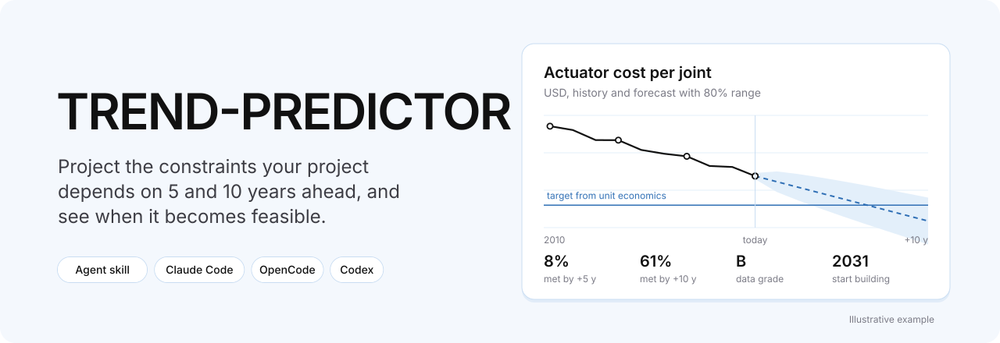
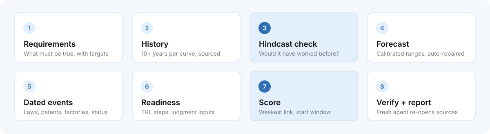
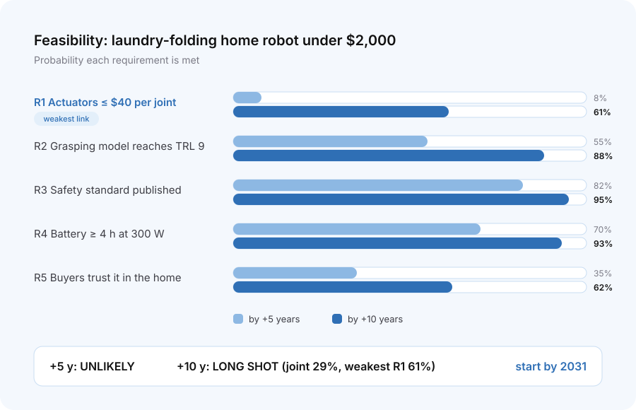

<div align="center">



<br>

**Agent skill that projects the constraints a project depends on 5 and 10 years ahead,<br>and tells you how likely it is to be feasible, what will hold it back, and when to start building.**

**English** | [Español](README/README_es.md) | [简体中文](README/README_cn.md)

[](LICENSE)
[](skills/trend-predictor/scripts/trend_predictor.py)

[Quick start](#quick-start) · [How it works](#how-it-works) · [Tested](#how-well-it-works) · [Install](#install) · [Usage](#usage) · [Limits](#limits) · [FAQ](#faq)

</div>

---

## Quick start

```bash
npx skills add qaemu/trend-predictor-skill
```

Or add it to Claude Code by hand, from the plugin marketplace:

```text
/plugin marketplace add qaemu/trend-predictor-skill
/plugin install trend-predictor@trend-predictor
```

> [!NOTE]
> TREND-PREDICTOR gives you probabilities, not prophecies. Every result is conditional ("61% by 2035 *if* the 2010–2025 trend continues") and written as a dated claim you can check later.

## Works best with PARADIGMA

TREND-PREDICTOR is the forward-looking half of a pair. [**PARADIGMA**](https://github.com/qaemu/paradigma-skill) looks back: which constraints in a field fell over the last years, who is building on each, and where the open gaps are. TREND-PREDICTOR looks forward: will a specific project become feasible as those constraints keep moving?

**Install PARADIGMA too.** Run it first on your field, then run TREND-PREDICTOR on the project you're considering:

```bash
npx skills add qaemu/paradigma-skill
```

- Both use the same data files (`points.csv`, `constraints.csv`, `noncost.csv`), so a PARADIGMA run is a head start: TREND-PREDICTOR reuses its sourced data instead of collecting it again.
- PARADIGMA (v0.4.2 and later) keeps the older data points it finds in `out_of_window.csv`. Forecasting needs 10+ years of history, so those older points matter here.
- PARADIGMA tells you **which** constraints matter; TREND-PREDICTOR collects denser history only for the 3–5 your project depends on.

## Why forecast constraints

A project is feasible when the things it depends on are cheap enough, good enough and allowed: actuators under a target cost, a battery above a target energy density, a regulation in force, a patent expired. Those things move on measurable trends, and the research on forecasting technology is clear about what works:

- **A technology's own past trend, extended with honest error ranges, beats expert panels** on cost and performance up to about 10 years ([Farmer & Lafond 2016](https://arxiv.org/abs/1502.05274); [Meng et al. 2021](https://www.cmcc.it/article/recent-technology-cost-forecasts-underestimate-the-pace-of-technological-change)). Experts and big institutional models were systematically too pessimistic: models expected solar costs to fall 2.6% a year in 2010–2020, and they fell about 15%.
- **Announcements overshoot.** About 11% of announced 2030 hydrogen capacity had reached a final investment decision (IEA, 2025).
- **Too early looks the same as wrong.** Knowing *when* a constraint should cross your threshold matters as much as knowing *whether*.

| It is | It is not |
|---|---|
| A probability per requirement and horizon, computed in code | A guess written in prose |
| Ranges tested on each series' own history before they're trusted | Straight lines drawn into the future |
| Explicit about which numbers are judgment defaults | A claim of precision it doesn't have |
| A list of dated, checkable predictions | A one-off opinion |

## How it works



| Step | What happens |
|---|---|
| **1. Requirements** | Breaks the project into what must be true: cost or performance **targets** derived from unit economics, dated **events** (laws, patent expiries, factories), **readiness** steps (TRL), and **judgment** items backed by crowd forecasts or published surveys. Names the constraint that changed recently, or flags "too early" risk. |
| **2. History** | Helper agents collect 10+ years per curve, each point with a link, one product line per series. Reuses PARADIGMA's data when it exists. |
| **3. Hindcast check** | Before trusting a series, the engine forecasts it from every past year and checks how often reality fell inside its ranges. |
| **4. Forecast** | Calibrated ranges (Farmer–Lafond random walk with drift, Student-t). Automatic repairs for mixed products, outliers, trend changes and physical limits, each chosen by an explicit test. Series that are still too noisy get a research agent sent for denser data. |
| **5. Dated events** | Laws with effective dates, patent expiries, standards, announced factories, each discounted by its status (announced, final investment decision, under construction). |
| **6. Readiness** | Technology readiness steps with evidence, and judgment inputs from Metaculus, Manifold or published elicitations. |
| **7. Score** | Probability each requirement is met by +5 and +10 years, the joint probability next to the **weakest link**, a verdict, sensitivity, a pre-mortem, and the **start window**: the year to start building, given your lead time. |
| **8. Verify + report** | A fresh agent that did none of the research re-opens every source. Report, fan charts, workbook and a log of predictions to score later. |

### Ground rules

1. **Every number has a link.** Missing data is reported as missing, never estimated.
2. **The math is done in code** ([`trend_predictor.py`](skills/trend-predictor/scripts/trend_predictor.py)), never by the model.
3. **Check the method on the data first.** No series is trusted until its hindcast has run.
4. **Report the weakest link next to the joint probability.** A project can't do better than its worst requirement.
5. **Write every result as a dated, checkable prediction**, so later runs can score earlier ones.

## What you get

<div align="center">

<br>
<sub>Illustration of the feasibility chart. A real run scores your project's requirements.</sub>
</div>

<br>

| Verdict | Rule |
|---|---|
| **Likely feasible** | Weakest requirement ≥ 80% and joint ≥ 60% |
| **Plausible** | Joint ≥ 35% |
| **Long shot** | Joint ≥ 12% |
| **Unlikely** | Joint < 12% |

**Deliverables**

- **Report.** The verdict per horizon first, with the weakest link, start window and the one thing to watch. Then one card per requirement (target and how it was derived, fan chart, trend, calibration result, repairs applied, probability per horizon), a timeline of dated events, readiness, a pre-mortem, signposts to watch and a re-check date, and method, confidence and sources.
- **Workbook (.xlsx).** Opens on **Start here**, which explains every term in plain words, then the project score, each requirement's probabilities, the series fits, the forecast ranges, calibration, events, signposts, the predictions log and every data point with its link.
- **Charts.** One fan chart per curve (history, median forecast, 50/80/95% ranges, target, limits) and the feasibility chart.

## How well it works

Every test suite runs offline, and its output is committed in [`tests/results/`](tests/results/SUMMARY.md).

| Suite | What it checks | Result |
|---|---|---|
| [`test_engine`](tests/results/test_engine.txt) | Calibration on 60 simulated technologies; end-to-end forecast, feasibility, charts, workbook | 13 / 13 |
| [`test_edge_cases`](tests/results/test_edge_cases.txt) | Inflation, bad rows, mixed date formats, gaps, physical limits, mixed products, missing files, overrides | 34 / 34 |
| [`test_autofix`](tests/results/test_autofix.txt) | The automatic repairs stay out of the way on clean data and help on real trend changes and outliers | 7 / 7 |
| [`test_real_data`](tests/results/test_real_data.txt) | Backtest on real, sourced data | 12 / 12 |

What the numbers say, without spin:

- **Calibration.** On simulated technologies, the 80% ranges contain 77% of outcomes and the 95% ranges 93%. That's close to honest, slightly narrow.
- **Repairs.** On clean data they trigger for 1–3% of series and leave accuracy unchanged. On a real slowdown they trigger in about half the cases and cut forecast error by 20–37%. When a slowdown is buried in heavy noise, they mostly don't trigger, because the data can't tell it apart from chance.
- **Real data** ([example](examples/backtest-predictive-maintenance)): wage forecasts made from 2013–2017 were within about 3% of what happened. Forecasts made from 2019 missed 2020–2023, when the COVID jump and then inflation moved real wages. An 80% range is supposed to miss about 1 time in 5, and no trend model foresees a shock. For noisy GPU launch prices and a thermal-camera series that mixes product types, the engine correctly refuses to give an informative 10-year forecast and asks for denser data.

## Example

A backtest on the sourced data from PARADIGMA's predictive-maintenance run is in [`examples/backtest-predictive-maintenance`](examples/backtest-predictive-maintenance). It stands in 2013, 2015, 2017 and 2019, forecasts with only the data available then, and compares with what actually happened. Every forecast, range and error is in `output/backtest.csv`.

## Install

TREND-PREDICTOR follows the open [Agent Skills](https://agentskills.io) format: a `SKILL.md` plus a Python engine. Any agent that can browse the web, run Python and, ideally, start helper agents can use it.

### Any agent (skills CLI)

```bash
npx skills add qaemu/trend-predictor-skill                    # current project
npx skills add qaemu/trend-predictor-skill -g                 # all projects
npx skills add qaemu/trend-predictor-skill -a claude-code -a opencode
```

Uses the [skills CLI](https://github.com/vercel-labs/skills), which supports Claude Code, OpenCode, Codex, Cursor and many more. Add `qaemu/paradigma-skill` the same way.

### Claude Code

As a plugin, which gives you updates through `/plugin`:

```text
/plugin marketplace add qaemu/trend-predictor-skill
/plugin install trend-predictor@trend-predictor
```

Plugin skills are namespaced, so you run it as `/trend-predictor:trend-predictor "<project>"`.

Or as a personal skill, which you run as `/trend-predictor "<project>"`:

```bash
git clone https://github.com/qaemu/trend-predictor-skill.git
mkdir -p ~/.claude/skills && cp -r trend-predictor-skill/skills/trend-predictor ~/.claude/skills/
```

### Claude apps (web, desktop, mobile)

1. Download [`dist/trend-predictor.zip`](dist/trend-predictor.zip). It contains the `trend-predictor` folder with `SKILL.md` and the engine.
2. Turn on **Code execution and file creation** in **Settings → Capabilities**.
3. Go to **Customize → Skills**, click **+**, then **Create skill → Upload a skill**, and choose the ZIP.

See Anthropic's guide: [Use skills in Claude](https://support.claude.com/en/articles/12512180-use-skills-in-claude).

### OpenCode

```bash
git clone https://github.com/qaemu/trend-predictor-skill.git
mkdir -p ~/.config/opencode/skills && cp -r trend-predictor-skill/skills/trend-predictor ~/.config/opencode/skills/
```

OpenCode also reads `~/.claude/skills/`, so a Claude Code install works there too. Check that web search works with your provider first. Without it, the skill can't collect data.

### Requirements

| Needs | Why |
|---|---|
| Web search and page fetching | Every number comes from a source |
| Python 3.10+ with `pandas`, `numpy`, `matplotlib`, `openpyxl` (`scipy` recommended) | The engine, its charts and the Excel workbook. `scipy` gives exact Student-t ranges |
| Helper agents (optional) | Parallel research and the independent check. Without them it runs one step at a time and marks the check as self-checked |

## Usage

```text
/trend-predictor "<project>" [field] [region] [horizons] [standard|deep]
/trend-predictor scan "<field>" [region] [horizons]
```

| Argument | Default | Notes |
|---|---|---|
| `project` | required | What it delivers, to whom and at what price. If that's too vague to set targets, the skill asks once |
| `scan` | — | Instead of one project: which thresholds in a field are most likely to be crossed, turned into 3–5 candidate projects and scored |
| `field` | inferred | Used to find a PARADIGMA run to reuse |
| `region` | global | Notes where the data is US- or EU-centric |
| `horizons` | `5,10` | Years after the last full year. 1–15 allowed; beyond 10 the output is scenarios, not forecasts |

```text
/trend-predictor "home robot that folds laundry for under $2,000" robotics global
/trend-predictor "solar-powered cold storage for small farms" agriculture "Latin America"
/trend-predictor scan "grid storage" global 5,10
```

> [!IMPORTANT]
> A full run collects sourced history with several agents in parallel and uses a substantial part of a plan's usage. Use it for an idea you're seriously considering, not for brainstorming.

## Which model to run it on

What matters is discipline about sources and following the procedure over a long run.

| Role | Recommended | Effort |
|---|---|---|
| Main run (requirements, scoring, report) | Claude Opus 5.5 | high |
| Data-collection helpers | Claude Sonnet 5.5 | medium–high |
| Independent check | Opus 5.5 | high |

To check any model, run it on 3 curves with well-published data, such as lithium-ion pack prices and solar module prices, then open every link it returns. **If it invents even one link or number, it fails.**

## The math

<details>
<summary><b>How a curve is forecast</b></summary>

<br>

1. **Normalize.** Values per unit of performance, in constant dollars (US CPI from FRED). Non-USD values need a cited exchange rate.
2. **Yearly value.** The median of each year's points, or, when a series mixes products, the best value available so far (the price-performance frontier).
3. **Fit** ([Farmer & Lafond 2016](https://arxiv.org/abs/1502.05274)). The log value is a random walk with drift: drift = (last − first) / years; volatility K from the yearly changes, with gaps scaled by √Δt.
4. **Ranges.** Median = last value + drift × τ. Spread = K·√(A*/(1+θ²)) with A* = −2θ + (1 + 2(m−1)θ/m + θ²)(τ + τ²/m), θ = 0.63, Student-t quantiles with m−1 degrees of freedom.
5. **Probability.** P(the value is at least as good as the target in year Y), straight from the forecast distribution. A target beyond a physical limit gets 0.
6. **Long-range widening.** Beyond 5 years, ranges for physical technologies widen by up to 40% at 10 years, because long-range forecasts of physical technologies miss more than those of information technology.

</details>

<details>
<summary><b>The automatic repairs</b></summary>

<br>

| Problem | Test | Repair |
|---|---|---|
| Mixed products | Values in the same year differ more than 3× | Best available value so far (frontier) |
| Outliers | A yearly change more than 5.5 robust SDs from typical | Robust trend (Theil–Sen) and volatility (MAD) |
| Trend changed | Drift in the last 15/10/8 years vs before, z > 3.2 under Farmer–Lafond errors | Fit on the recent window |
| Physical limit | The straight trend crosses a sourced floor or ceiling inside the horizon | Model the remaining gap to the limit, so progress slows near it |

Repairs are chosen by explicit tests, not by trying many fits and keeping the best. An earlier version did the latter; it looked better on real data and was worse on clean simulated data, because it was fitting noise.

</details>

<details>
<summary><b>Judgment defaults (labelled in every report)</b></summary>

<br>

| Default | Value | Why it's a judgment |
|---|---|---|
| Event priors (by date / within 3 years) | Patent granted 0.90/0.97 · regulation enacted 0.75/0.92, proposed 0.30/0.55 · capacity announced 0.25/0.45, final investment decision 0.60/0.85, under construction 0.75/0.92 | Few measured base rates exist; the hydrogen and battery pipelines inform the capacity values |
| Readiness | Median years per TRL step: software 0.6, electronics 1.3, hardware 2.0, energy 2.5, infrastructure 3.0 | Evidence on TRL transition times is thin (GPS TRL 3→9 took 11.7 years) |
| Widening | Physical domains: spread × (1 + 0.4·(h−5)/5) beyond 5 years | Direction is documented, size is not |

</details>

<details>
<summary><b>Run the engine on its own</b></summary>

<br>

```bash
cd skills/trend-predictor/scripts
python3 trend_predictor.py cpi                                   # US CPI annual averages from FRED
python3 trend_predictor.py hindcast --end 2025                   # points.csv -> hindcast.csv, calibration.csv
python3 trend_predictor.py forecast --end 2025 --plots           # -> series_fit.csv, forecasts.csv, plots/
python3 trend_predictor.py feasibility --end 2025 --lead-years 2 --plots   # requirements.csv -> project score
python3 trend_predictor.py workbook --project "…" --end 2025 --date 2026-10-16
```

The CSV schemas are in [`SKILL.md`, Appendix B](skills/trend-predictor/SKILL.md#appendix-b-csv-schemas).

</details>

## Data sources

Every source is free. The report says where paid databases would add more.

| Need | Used (free) | What professionals add (paid) |
|---|---|---|
| Cost and performance history | Our World in Data, Santa Fe Performance Curve Database, Epoch AI, BLS / FRED, USGS, NREL, IEA, NHGRI, learning-curve papers, price lists + Wayback Machine | BloombergNEF, teardown firms |
| Dated events | Official gazettes (Federal Register, EUR-Lex, national gazettes), Google Patents, Lens.org, ISO / IEC / IEEE | Legal and patent trackers |
| Judgment inputs | Metaculus, Manifold, Good Judgment Open, published expert elicitations | Commissioned expert panels |

## Limits

- **Up to 10 years.** The ranges are validated up to about 10–11 years. Beyond that, the output is scenarios.
- **Adoption is not forecast.** The skill scores whether a project becomes *feasible*, not how fast people will buy it. No method forecasts adoption timing reliably; real customers are the only measurement.
- **It needs data.** Series with fewer than 5 yearly changes get no forecast, and noisy ones are reported as uninformative. Most fields have only a few good long series.
- **Shocks aren't foreseen.** A pandemic, a war or a sudden policy change moves values outside the ranges. The ranges account for typical surprises, not every surprise.
- **Some numbers are judgment.** Event, readiness and widening defaults are labelled and tunable.
- **Status: v0.1, experimental.** Tested on simulated data and one real backtest. No full real project run has been published yet.

## FAQ

**Does it touch my files or accounts?**
No. It reads public websites and writes only to its own working folder.

**Why not just ask a model when something will be feasible?**
Because it will give you a confident date, and you won't be able to tell what it's based on. This skill requires a source for every number, does the math in code, tests its own method on each series' history, and writes every claim so it can be checked later.

**How is it different from PARADIGMA?**
PARADIGMA maps what already changed in a field, and who is building on it. TREND-PREDICTOR scores one project's chances at future dates. Run PARADIGMA first to find where to look, then TREND-PREDICTOR on what you'd build there.

**Can I trust a 10-year probability?**
As a ranking and a sanity check, yes. As a precise number, no: treat 61% as "more likely than not, if trends hold", and watch the signposts the report gives you.

## Repository

```text
trend-predictor-skill/
├── .claude-plugin/              Claude Code marketplace + plugin manifests
├── skills/trend-predictor/
│   ├── SKILL.md                 instructions the agent follows
│   └── scripts/trend_predictor.py   engine (cpi, hindcast, forecast, feasibility, workbook)
├── tests/                       four offline suites + run_all.sh
│   └── results/                 committed output of the last run (SUMMARY.md)
├── examples/                    backtest on real, sourced data
├── docs/research.md             the research behind the method, with sources
├── dist/trend-predictor.zip     ready-to-upload skill for Claude apps (tools/package.sh)
├── tools/                       make_assets.py (README artwork), package.sh (rebuilds the ZIP)
├── README/                      translations of this page
└── assets/                      banner, pipeline and feasibility art
```

```bash
./tests/run_all.sh   # runs all suites, rewrites tests/results/
```

## Contributing

Issues and pull requests are welcome, especially:

- real runs you're willing to share in `examples/`, ideally with outcomes you can check later
- long, clean, free data series for a specific technology
- better base rates for the judgment defaults (event delays, TRL transition times)

Keep the rules intact: every number gets a source, and all math stays in the engine.

## License

[MIT](LICENSE) © 2026 qaemu

<div align="center">
<br>
<sub>Built by <a href="https://github.com/qaemu">qaemu</a>. Also by the same author: <a href="https://github.com/qaemu/paradigma-skill">PARADIGMA</a>, the constraint-shift panorama this skill builds on, and <a href="https://github.com/qaemu/phasentic">Phasentic</a>, open-source powder XRD phase identification.</sub>
</div>
