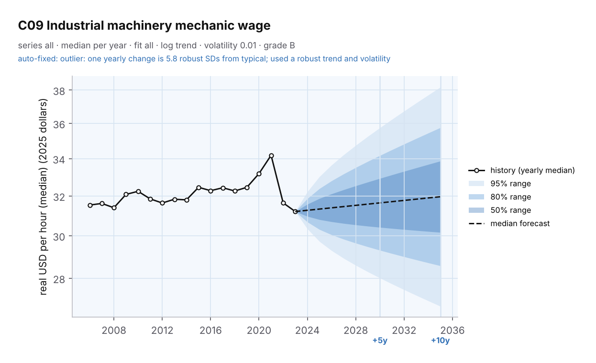
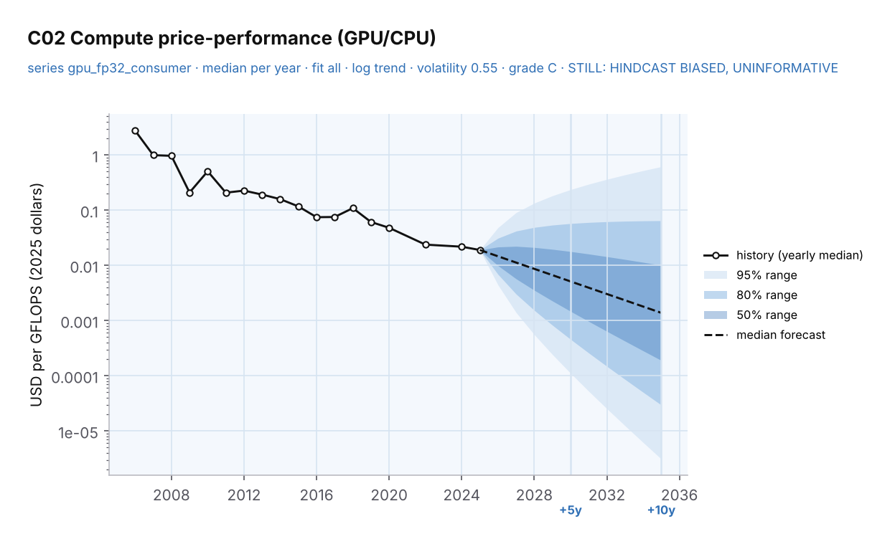
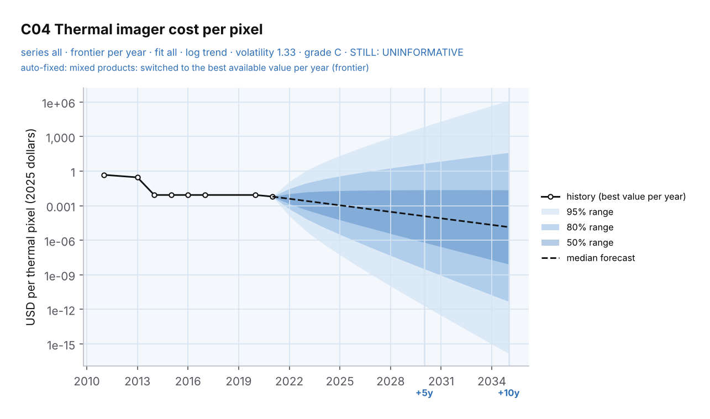

# Backtest: predictive-maintenance data

> Example for [TREND-PREDICTOR](../../README.md). It uses the sourced data from [PARADIGMA's predictive-maintenance run](https://github.com/qaemu/paradigma-skill/tree/main/examples/predictive-maintenance) (`data/`, copied unchanged; every point has its source URL). Reproduce it with `python3 tests/test_real_data.py`.

**What this is.** A test of the forecasting method on real data, not a project feasibility run. It stands in a past year, forecasts using only the data available then, and compares the forecast with what actually happened.

## Which series could be forecast

The PARADIGMA run has 114 points across 26 series. Only 3 have enough consecutive yearly history to forecast at all (the engine needs at least 5 yearly changes). That isn't a fault in PARADIGMA: it answers "did this fall a lot?", which needs much less history than forecasting does.

| Series | Points | Today's verdict from the engine | Why |
|---|---|---|---|
| C09 Industrial machinery mechanic wage (BLS) | 18 years | **Grade B, informative** (10-year 80% range about 1.2× wide) | Smooth official statistic. One outlier year (2022) repaired with a robust trend |
| C02 GPU price per GFLOPS (launch prices) | 30 points, 18 years | **Grade C, uninformative** (10-year 80% range over 100× wide) | Only 1–3 launch prices per year in the early years, so the noise is too large to tell a trend change from chance. Needs denser data |
| C04 Thermal imager price per pixel | 11 points, 8 years | **Grade C, uninformative** | Mixes handheld cameras with bare sensor modules. Repaired to the best-available frontier, but 11 points is still too little |

## Backtest results

Average error is the geometric mean of actual ÷ forecast (1.00 = perfect). Full detail per year in [`output/backtest.csv`](output/backtest.csv); summary in [`output/backtest_summary.csv`](output/backtest_summary.csv).

| Series | Forecast made in | Years checked | Inside the 80% range | Average error | 10-year range width |
|---|---|---|---|---|---|
| Wages | 2013 | 10 | 100% | ×1.02 | 1.2× |
| Wages | 2015 | 8 | 100% | ×1.02 | 1.2× |
| Wages | 2017 | 6 | 100% | ×1.03 | 1.2× |
| Wages | 2019 | 4 | **25%** | ×1.04 | 1.2× |
| GPU | 2013 | 10 | 100% | ×2.91 | 4,192,720× |
| GPU | 2015 | 8 | 100% | ×2.40 | 175,707× |
| GPU | 2017 | 6 | 100% | ×2.10 | 29,608× |
| GPU | 2019 | 4 | 100% | ×1.33 | 13,669× |

**How to read it:**
- **Wages forecast well**, except from 2019: 2020 jumped (COVID changed who was still employed) and 2021–2023 fell about 9% in real terms (inflation). An 80% range is supposed to miss about 1 time in 5, and no trend model foresees a shock. Across all four starting years, 89% of later values fell inside.
- **GPU forecasts are "right" but useless.** Reality always fell inside the range, because the range was enormous. The engine correctly labels this series uninformative and grade C, so it can't carry a headline. The fix is data, not math: every GPU model each year, or a published price-performance dataset, instead of a few flagship launch prices.

## Current forecasts (from 2025)

| Wages | GPU | Thermal imagers |
|---|---|---|
|  |  |  |

Engine outputs: [`series_fit.csv`](output/series_fit.csv) (trend, volatility, repairs, grade, warnings), [`forecasts.csv`](output/forecasts.csv) (ranges per year), [`hindcast.csv`](output/hindcast.csv) and [`calibration.csv`](output/calibration.csv) (how the default method did on each series' own history).
